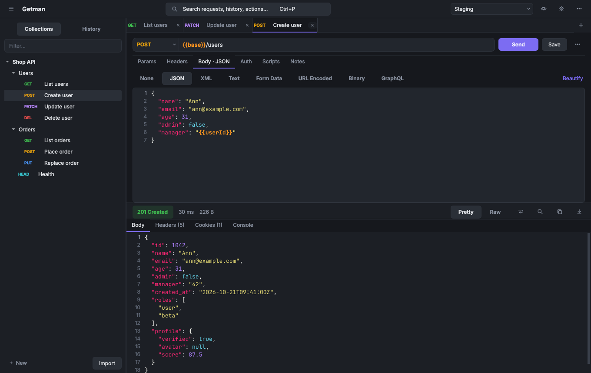

# Getman

Быстрый локальный HTTP-клиент для отладки API. Без аккаунтов, облака и телеметрии.
Все данные хранятся в обычных JSON-файлах рядом с приложением. Потребление памяти — **до 50 МБ**.



## Возможности

- **Вкладки** с методом и признаком несохранённых изменений. Перетаскивание, закрытие средней кнопкой мыши.
  Открытые вкладки, включая несохранённые правки, восстанавливаются после перезапуска.
- **Коллекции и папки**: перетаскивание мышью, переименование по F2, дублирование, экспорт в Getman JSON или Postman v2.1.
- **Окружения, глобальные переменные и переменные коллекции**. `{{переменные}}` работают везде:
  в URL, параметрах, заголовках, теле и авторизации. Они подсвечиваются (известная — оранжевым, неизвестная — красным),
  при наведении показывают значение и источник. Есть динамические переменные: `{{$guid}}`, `{{$timestamp}}`,
  `{{$isoTimestamp}}`, `{{$randomInt}}` и другие.
- **Автодополнение**:
  - после `{{` — переменные со значениями;
  - в адресной строке — URL из истории и коллекций;
  - в таблицах — имена и значения заголовков и параметров (стандартные + встречавшиеся в истории).
  - Ctrl+Space показывает подсказки принудительно.
- **Импорт** с автоопределением формата: Postman Collection v2.0/v2.1, Postman Environment и дамп «Export data»,
  Insomnia v4 (JSON) и v5 (YAML), OpenAPI 3.0/3.1 и Swagger 2.0 (JSON/YAML), HAR из DevTools браузера,
  `.http`/`.rest` (JetBrains / VS Code REST Client), cURL.
  - Источник: файл (в том числе перетаскиванием в окно), вставленный текст или ссылка.
  - Перед импортом показывается дерево с галочками: из большой OpenAPI-спецификации можно взять только нужные эндпоинты.
  - cURL, вставленный прямо в адресную строку, сразу разбирается в запрос.
- **Тело запроса**: JSON (с проверкой синтаксиса и кнопкой Beautify, которая не ломает `{{переменные}}`), XML, Text,
  Form Data (в том числе файлы), URL Encoded, Binary, GraphQL.
- **Авторизация**: Bearer, Basic, API key (в заголовке или query). Наследуется от папки или коллекции.
- **Path-переменные** в стиле Postman: `/users/:id`. Параметры query синхронизируются с URL в обе стороны.
- **Ответ**:
  - статус, время (и время до первого байта), размер;
  - режимы Pretty / Raw, превью картинок, поиск (Ctrl+F);
  - вкладки заголовков и cookies;
  - вкладка «Console»: что реально ушло на сервер (с подставленными переменными) и вывод скриптов.
- **Скрипты на Python** до и после запроса: подпись запроса, извлечение токена из ответа в окружение, тесты (`test()`).
- **Палитра Ctrl+P**: поиск по запросам, истории, окружениям и командам.
- **Copy as cURL** с подставленными переменными.
- **История**, сгруппированная по дням.
- **Две темы** (тёмная и светлая), раскладка «ответ снизу» или «ответ справа».
- **Понятные сетевые ошибки**: «Соединение отклонено», «Не удалось разрешить хост», таймаут, SSL и т. п.

## Установка и запуск

```bash
pip install -r requirements.txt
python main.py
```

Готовый Windows-exe собирается так: `pyinstaller Getman.spec`. В CI это делает workflow «Build Windows Portable».

## Горячие клавиши

| Клавиши | Действие |
|---|---|
| Ctrl+Enter / Esc | Отправить / отменить запрос |
| Ctrl+T / Ctrl+W | Новая вкладка / закрыть вкладку |
| Ctrl+S / Ctrl+Shift+S | Сохранить / сохранить как |
| Ctrl+P или Ctrl+K | Быстрый поиск запросов и команд |
| Ctrl+L | Фокус в адресную строку |
| Ctrl+E | Окружения |
| Ctrl+I | Импорт |
| Ctrl+Shift+C | Скопировать как cURL |
| Ctrl+F | Поиск в ответе |
| Ctrl+B | Скрыть или показать боковую панель |
| Ctrl+, | Настройки |

## Скрипты

```python
# Pre-request: подписать тело запроса
secret = env.get("secret", "")
request.headers["X-Signature"] = hmac.new(secret.encode(), (request.body or "").encode(),
                                          hashlib.sha256).hexdigest()

# Post-response: сохранить токен (уйдёт в активное окружение) и проверить ответ
env["token"] = response.json()["access_token"]
test("status is 200", response.status == 200)
```

Доступны:

- `env` — переменные; присваивание сохраняется в активное окружение;
- `variables` — переменные только для этого запроса;
- `request` / `response`, `test()`, `log()`;
- модули `json`, `re`, `time`, `datetime`, `hashlib`, `hmac`, `base64`, `uuid`, `random`.

JavaScript-скрипты из Postman при импорте сохраняются закомментированными, чтобы их можно было перенести вручную.

## Память

Бюджет — **50 МБ** приватной рабочей памяти. Это колонка «Память» в Диспетчере задач Windows.
Что для этого сделано:

- **Сеть** — встроенный в Qt `QtNetwork`, а не httpx: −20 МБ, без потоков и asyncio.
- **Подсветка синтаксиса** своя, без Pygments.
- **Редактор запроса один на все вкладки**: каждая вкладка — это только данные.
- **Разделы интерфейса создаются при первом открытии.**
- **Тяжёлые модули импортируются лениво.**
- **Иконки рисуются кодом**, без эмодзи и символьных шрифтов: на Windows первый символ, которого нет
  в Segoe UI, заставляет Qt подгрузить подстановку шрифтов, а это +14 МБ.

Проверить бюджет:

```bash
pip install -r requirements-dev.txt
python tools/memcheck.py --budget 50 --busy-budget 55
```

Замеры в CI на Windows (колонка «Память» Диспетчера задач):

| Состояние | Память |
|---|---|
| пустое окно PySide6 (для сравнения) | 25 МБ |
| Getman после запуска | 42–43 МБ |
| стресс: все разделы открыты, 5 вкладок, 40 запросов | около 50 МБ |

На Linux те же сценарии дают около 31 и 37 МБ.
Очень большие ответы (десятки мегабайт) увеличивают потребление пропорционально размеру. Выше 20 МБ ответ
показывается усечённым, целиком его можно сохранить в файл.

## Данные

По умолчанию данные лежат в папке `data/` рядом с приложением (портативный режим). Если эта папка только для чтения,
используется профиль пользователя (`%APPDATA%\Getman`, `~/.local/share/getman`). Путь можно задать переменной
окружения `GETMAN_DATA_DIR`.

Коллекции и окружения старых версий Getman автоматически переводятся в новый формат при первом запуске.
Резервная копия и восстановление — в «Настройки → Data».

## Разработка

```bash
pip install -r requirements-dev.txt
python -m pytest -q tests      # ядро + сквозные UI-тесты против локального HTTP-сервера
```

Архитектура и правила для разработчиков и AI-агентов описаны в [GEMINI.md](GEMINI.md)
(`CLAUDE.md` и `AGENTS.md` — ссылки на этот файл).
